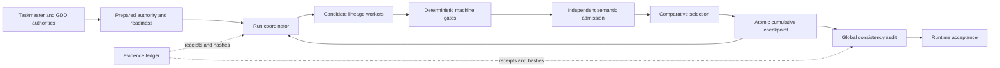

# Architecture Spine — NewRouge MVG Planning

> **Target architecture, migration pending.** This spine follows the finalized MVG PRD/SPEC. Current `workflow.md` and `plan-mvg` Skill still define whole-candidate selection with optional incumbent D; current code has candidate-local append ledgers, not shared selected Capability checkpoints. Until those owning sources and implementation migrate, they describe current behavior; do not treat target-only rules below as deployed.

## Design Paradigm

The workflow is a deterministic staged pipeline governed by an explicit state machine. Each stage consumes an immutable, hash-bound envelope and emits an append-only receipt; only the coordinator can advance state or mutate the accepted cumulative baseline. The evidence ledger is the audit substrate, not a second source of product authority.

## Invariants & Rules

### AD-1 — Coordinator owns lifecycle state [TARGET]

- **Binds:** CAP-1, CAP-2, CAP-5, CAP-6; `plan_mvg.py`
- **Prevents:** Independently implemented stages inventing incompatible transitions, retries, or terminal states.
- **Rule:** A single run coordinator owns run, Capability checkpoint, candidate lineage, budget, recovery, and terminal state. Stage workers return typed results and receipts; they cannot write the selected cumulative baseline or advance the selected Capability sequence themselves. Current `run_capability_append` persists a candidate-local accepted chain and iterates its scopes; that behavior remains implementation reality until the target coordinator/checkpoint migration replaces it.

### AD-2 — Capability authority and readiness are immutable inputs [ADOPTED]

- **Binds:** CAP-1, CAP-4; capability baseline and Chapter 5 readiness preparation.
- **Prevents:** A candidate silently consuming a different Capability version, task scope, Requirement set, or readiness snapshot.
- **Rule:** `capabilities.v1.json`, its hash/source revision, the selected Chapter 5 readiness snapshot, and prepared evidence inventory are frozen before generation. Any identity drift blocks the run and requires a new preparation.

### AD-3 — Candidate lineage isolation is mandatory [ADOPTED]

- **Binds:** CAP-1, CAP-5; generation, repair, and replacement workers.
- **Prevents:** Failed model context or unadmitted artifacts contaminating another candidate or a clean restart.
- **Rule:** Each candidate has an independent lineage and workspace. Prompts, findings, proposals, receipts, and workspaces cross a boundary only through an explicitly accepted, hash-bound artifact; a clean restart reads immutable prepared inputs and accepted predecessors only.

### AD-4 — Deterministic gates precede semantic admission [ADOPTED]

- **Binds:** CAP-4; schema, preflight, reference, coverage, handoff, and cumulative-delta validators.
- **Prevents:** Semantic review being used to repair malformed JSON, missing identity, truncated evidence, illegal selectors, or invalid cross-references.
- **Rule:** Complete transport/preflight and deterministic machine validation must pass before an independent semantic admission call. A machine-rejected proposal is not selectable and is never presented as a semantic verdict.

### AD-5 — Selected checkpoint identity is deterministic [TARGET]

- **Binds:** CAP-2, CAP-6; selection, merge, apply, and recovery.
- **Prevents:** Partial cumulative MVG writes, stale candidate application, or replaying one increment twice.
- **Rule:** A selected checkpoint transaction identity is `sha256(canonical_json({schema_version, run_id, capability_id, order_index, base_sha256, proposal_sha256, selection_receipt_sha256}))`. Persist the complete identity tuple before merge writes; the checkpoint payload must contain the same tuple. Recovery locates by this identity and verifies byte-canonical payload equality. The coordinator writes the selected delta and checkpoint atomically; failure leaves the prior accepted baseline unchanged. Replaying an identical transaction is a no-op; the same identity with different payload blocks.

### AD-6 — Route membership and verification ownership are separate [TARGET]

- **Binds:** CAP-3; manifest coverage, Knowledge summaries, and migration validators.
- **Prevents:** A Requirement referenced by multiple flows being counted as multiple completions or being rejected as an invalid duplicate solely because routes differ.
- **Rule:** Route membership uses `(requirement_id, flow_id)`; authoritative verification uses `requirement_id`; evidence references use `(requirement_id, evidence_id)`. Shared evidence may serve multiple routes only with its covered behavior recorded. Duplicate keys are structural errors. Until the proposal/manifest migration is complete, existing `coverage_table` remains the current one-row-per-Requirement projection; migration preserves its disposition as the authoritative record and projects the prior flow owner into route membership.
- **Projection:** `flow` and `other_verification` are satisfied only with their required authoritative evidence; `deferred` is accounted but not satisfied and must retain its authority; `source_gap` is neither satisfied nor complete and blocks planning completion. Reports must expose accounted and satisfied separately.

### AD-7 — Bounded repair and explicit budget termination [TARGET]

- **Binds:** CAP-5; repair, replacement, and run accounting.
- **Prevents:** Infinite retries, silent budget expansion, and classifying execution exhaustion as semantic rejection.
- **Rule:** A stable hard issue receives at most three repairs. A candidate lineage retires at 64 durable invocation attempts. Each run binds positive `mvg.run_invocation_limit` (default 192) across all candidates and Capabilities. Reserve and persist one budget unit immediately before dispatching a model invocation; preparation failures before dispatch consume none, while timeout, malformed output, and transport failure after dispatch remain charged. Recovery reuses a persisted completed receipt or allocates and charges a new attempt; an absent response is never a free retry. Exhaustion produces `run_blocked_budget_exhausted` and preserves recovery evidence.

### AD-8 — Selection admits only complete candidate sets [TARGET]

- **Binds:** CAP-1, CAP-2; comparative selection and Capability progression.
- **Prevents:** A hard-invalid candidate winning by default, an incumbent masking generation failure, or a later Capability consuming an incomplete baseline.
- **Rule:** Exactly three admitted candidates are required for a Capability selection. The accepted baseline is a read-only seed, not a fourth candidate or fallback. Fewer than three admitted candidates produces `selection_blocked_insufficient_admitted_candidates` and does not advance.

### AD-9 — Global audit owns explicit reopen decisions [TARGET]

- **Binds:** CAP-2, CAP-6; final audit and conflict recovery.
- **Prevents:** Local overlap being treated as a global conflict or historical selections being silently rewritten.
- **Rule:** Current-increment repair is the default. Only a source-backed real hard conflict identified by global audit may create a reopen plan. A reopened checkpoint invalidates every later checkpoint in the ordered cumulative ancestry; a narrower closure is allowed only after deterministic rebase proof shows its exact base hash and accepted-predecessor set remain valid. Persist the computed closure and replacement order. The plan records evidence, affected Capability/flow, invalidated downstream increments, and replacement selections; unresolved conflict blocks planning completion.

### AD-10 — Planning and runtime authority remain separate [ADOPTED]

- **Binds:** CAP-6 and all workflow stages.
- **Prevents:** Planning artifacts mutating game runtime state, Taskmaster status, GDD authority, or claiming runtime verification.
- **Rule:** The MVG workflow owns planning evidence and manifest projections only. GDD/Requirements, Taskmaster triplets, Contracts, tests, and runtime acceptance retain their owning authority. `runtime_verified` can be produced only by formal MVG runtime acceptance.

### Dependency direction



The arrows are dependency direction. `I` never writes back into planning selection, and `C` never depends on another unadmitted `C` worker.

### Target lifecycle state projection

| Aggregate | States | Allowed forward transitions |
| --- | --- | --- |
| Run | `prepared`, `running`, `blocked`, `planning_complete` | `prepared -> running`; `running -> blocked` or `planning_complete`; blocked resumes only with matching input identity and unused bound budget. |
| Candidate slot | `empty`, `active`, `admitted`, `retired`, `execution_blocked` | `empty -> active`; `active -> admitted`, `retired`, or `execution_blocked`; a replacement gets a new lineage ID, never reopens a retired lineage. |
| Lineage | `generating`, `repairing`, `admitted`, `retired`, `blocked` | `generating -> repairing` on a hard issue; `repairing -> generating` for a new charged attempt; after three failed repairs `repairing -> retired`; a clean lineage starts separately from immutable roots. |
| Capability checkpoint | `pending`, `selected`, `merged`, `reopen_pending`, `invalidated` | `pending -> selected` only with three admitted candidates; `selected -> merged` atomically; global hard conflict may move an ancestor to `reopen_pending` and every later descendant to `invalidated`. |

State changes are coordinator-owned and append an event before exposing the new state. Resume derives state from the latest valid event plus hash-bound receipts and rejects impossible transitions; it does not infer success from file presence alone.

## Consistency Conventions

| Concern | Convention |
| --- | --- |
| Identity | Every run, Capability snapshot, candidate lineage, proposal, receipt, checkpoint, and evidence bundle has a stable ID plus content hash. |
| State mutation | Workers are append-only; coordinator-only atomic checkpoint writes; stale baseline hashes fail closed. |
| Error classes | Distinguish preparation/transport/runner errors, deterministic machine issues, semantic hard issues, budget exhaustion, and global conflicts. |
| Recovery | Reuse only exact hash-bound accepted artifacts allowed by the state machine; new page runs and clean restarts do not reuse failed context. |
| Requirement accounting | Route membership and authoritative verification use separate projections and stable keys defined in `requirement-accounting.md`. |
| Evidence | Full source text, ranges, citations, receipts, and reassembly proofs remain available under `logs/**`; summaries cannot replace source evidence. |
| Naming | Preserve existing entrypoints and artifact names; new stage/state names must use the stable enums in the implementation contract. |

## Stack

| Name | Version |
| --- | --- |
| Python CI compatibility | 3.12 (MVG integration workflow) |
| .NET SDK repository policy | 8.0.401 with `latestPatch` roll-forward (`global.json`); host resolved 8.0.415 on 2026-10-12 |
| Host platform | Windows-only repository target; version supplied by CI/host policy |

## Structural Seed

```text
scripts/python/
  plan_mvg.py                         # coordinator and stage entrypoints
  _mvg_capability_append.py           # lineage append state machine
  _mvg_capability_generation.py       # proposal schema and machine projection
  _mvg_planning_review.py             # deterministic planning/review validation
scripts/python/tests/                 # contract, append, transport, and recovery tests
docs/testing/mvg/                     # cumulative manifest and acceptance fixtures
logs/ci/mvg-planning/<run-id>/         # run ledger, evidence, receipts, and recovery state
docs/planning/semantic-topology/      # selected Capability authority
```

The tree is a seed, not a second ownership registry. Existing code owns detailed schemas and file layout once the architecture is implemented.

## Capability → Architecture Map

| Capability / Area | Lives in | Governed by |
| --- | --- | --- |
| CAP-1 candidate sequencing | `plan_mvg.py`, `_mvg_capability_append.py` | AD-1, AD-2, AD-3, AD-8 |
| CAP-2 cumulative merge and checkpoint | coordinator apply/merge path and MVG manifest ledger | AD-5, AD-9 |
| CAP-3 route and verification accounting | proposal validator, coverage projection, Knowledge summary | AD-6, AD-10 |
| CAP-4 transport and admission gates | generation/preflight/review validators and isolated runner | AD-2, AD-4 |
| CAP-5 repair, restart, and budgets | append ledger, repair router, run accounting | AD-3, AD-7 |
| CAP-6 global audit and runtime boundary | final validation, acceptance manifest, runtime acceptance harness | AD-9, AD-10 |

## Deferred

- The exact Chapter 5 readiness snapshot schema, path, and hash fields; settle during implementation design before its input contract is frozen, without weakening AD-2.
- The concrete shared-evidence disposition and route-scope fields; settle during implementation design before the proposal schema is frozen, preserving AD-6 keys and counting rules.
- The controlled CLI/UI operation for an explicit early-Capability reopen; settle before implementing reopen operations, preserving AD-9 evidence and impact records.
- The detailed migration format from the current whole-candidate append lifecycle to per-Capability selection checkpoints; migration must preserve accepted baseline and recovery identities.
- The current `workflow.md` §5.4 and `.agents/skills/plan-mvg/SKILL.md` selection contract must be updated in the same migration that implements AD-5 through AD-9; until then, their whole-candidate + optional incumbent-D behavior is current.
- The exact Knowledge UI progress projection; UI is a consumer of receipts, not an authority or state owner.
