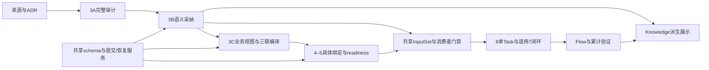
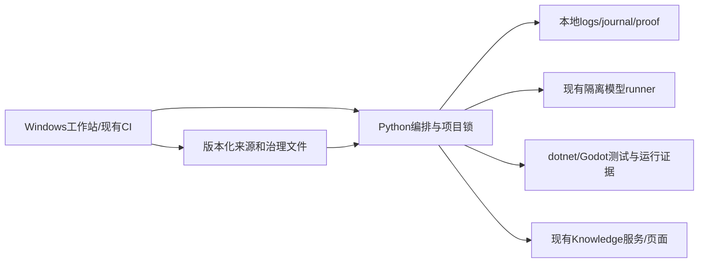

# newrouge B 路线架构主干

## Design Paradigm

采用确定性分阶段文件流水线与端口／适配器。来源审计、语义规划、采纳、Task 编译、绑定、实施和验证分阶段消费已提交输入；受治理记录可版本管理，Knowledge 是可重建投影。保持现有 Python 编排、C# Core／Godot 适配及文件 journal，不新增规划数据库。

本主干规定目标一致性约束，不表示 B 已实现。当前代码基线为 `cd925bdcae4b61992320773497f7edb729aac244`，文档输入提交为 `e9cd3d9cb4f054f04348013c1cba926675fcca49`。现存 MVG 子系统已有独立 worker、selected checkpoint 和完成项恢复；2026-10-12 的较窄 MVG 主干不是本 initiative 的上级主干，其旧 TARGET 标签不替代当前源码／ADR 事实。

## Invariants & Rules

### AD-1 — 权威与依赖方向 [ADOPTED]

- **Binds:** all
- **Prevents:** 规划、Knowledge 或运行报告成为第二套需求／任务状态权威。
- **Rule:** 来源与有效 ADR 管语义，采纳记录只保存从属来源的规划决定；Taskmaster 管唯一任务状态，Core 契约源码管程序契约，manifest 管累计义务，原始运行证据证明对应快照结果。派生拓扑不反写这些权威；游戏运行不依赖规划工具。新增治理及 Chapter 顺序通过显式 ADR 演进落实。

### AD-2 — 语义采纳与实施就绪分阶段 [ADOPTED]

- **Binds:** CAP-1–5
- **Prevents:** 零 Task 规划被 Task／Chapter5 readiness 或全局 witness 循环阻断。
- **Rule:** 3A 独立来源审计、3B 无 Task 正式采纳、3C 任务承接和4–5实施绑定使用不同阶段检查。3B 不要求 Task ID、readiness、完整代码符号或已建场景；5才检查当前 Task 的具体义务。现有后置 planner gate 通过显式阶段适配演进，不能以 draft 开关、假 Task／witness 绕过。

### AD-3 — 共享版本化记录与单一编解码

- **Binds:** CAP-2–5、CAP-9
- **Prevents:** 各生产者发明不同格式，或只靠本地缓存支撑正式任务。
- **Rule:** `docs/planning/b-route/` 存最小采纳、绑定、策略及提交记录；语义计划与绑定各自有不可变修订。一个受治理 schema／codec 模块拥有 `planning-records.md` 的公共形状、版本、路径、hash 与错误合同，各消费者调用它；不复制私有解析器。未知、损坏或缺失的必需格式阻断，迁移不静默降级。

### AD-4 — 稳定身份与需求核算分离 [ADOPTED]

- **Binds:** CAP-2–4、CAP-7
- **Prevents:** 重规划重分身份，共享需求重复完成，或一条 Flow 被误限一个 Capability。
- **Rule:** 复用既有 Requirement／Flow／Task 身份；新身份由采纳操作持久分配且查重，重试不再分配，改义保留 lineage 和差异。Flow 可跨 Capability，Task 与 Flow 多对多。继承现有 route-membership、unique-verification、shared-evidence 三组键及 `coverage_table` 兼容投影，不按路线数增加完成计数或复制规则正文。

### AD-5 — B 来源不可通过缺失信息退回 A

- **Binds:** CAP-5、CAP-9
- **Prevents:** 删除 B 标识、trace、适用性或 manifest 便被当作无义务 legacy。
- **Rule:** 切换策略及冻结 A 清单为必需版本化输入；只有 Task 定义／来源仍符合冻结边界且无当前 B 义务者可走 A。B origins 与 Task／计划引用双向一致，B 归属不可删回 A。策略、catalog、origins 或依据缺失／损坏／未知时拒绝，不从“没找到 trace”推断 legacy。

### AD-6 — 全入口共享 InputSet 门禁

- **Binds:** CAP-5、CAP-6、CAP-9
- **Prevents:** 页面、CLI、直接执行和恢复使用不同规则或产生自身完成死锁。
- **Rule:** Chapter5／6、direct CLI、resume／route 和页面调用同一 InputSet resolver／gate；核对来源、采纳、Task 定义、Acceptance、绑定、readiness 及适用义务。Flow／MVG 责任须有有效 manifest；合法无 MVG 非 Flow 须有已采纳适用性与其他验证。未知则拒绝。入口不要求当前 Task 已 done，producer／consumer／integration-only owner 按实际责任检查，不造 owner API。

### AD-7 — 三联写入与任务状态归属 [ADOPTED]

- **Binds:** CAP-4、CAP-5、CAP-9
- **Prevents:** 模型直写 tasks.json、候选默认值覆盖成熟状态，或状态变化使全部规划失效。
- **Rule:** 先盘点已有实现、完成Task、共享能力、四部分及验证责任，再仅为真实缺口产生经审阅的业务视图 delta，由既有三联编译路径写任务；保留 ID、状态、历史及严格 join。定义 fingerprint 与可变状态分开；依赖／运行参与者状态由入口另做实时资格检查。编译提交须合并当前状态并对整文件前像作冲突检查，不恢复 journal 中的旧状态覆盖新进度。

### AD-8 — journal 恢复与一致提交可见性

- **Binds:** CAP-3–5、CAP-8
- **Prevents:** 多文件半写被消费、重复施加 delta、覆盖后续人工编辑或假称跨文件原子事务。
- **Rule:** 复用 journal，在项目操作锁下绑定 operation ID、请求内容、全部 authority 与目标 before／after 身份，写持久 pending；预检及逐目标写前复核，冲突不覆盖。全部目标与最小提交 receipt 完成验证后，最后原子发布单一 catalog；消费者复验 receipt、当前相关目标及 catalog 前后身份，不仅看 pending 是否存在。未知提交、中断或占用须消歧／阻断；完成操作同内容 no-op，同 ID 异内容冲突。具体协议见伴随文件。

### AD-9 — 继承完成项恢复与 worker 边界 [ADOPTED]

- **Binds:** CAP-3、CAP-8、CAP-10
- **Prevents:** 用内容命中绕过当前兼容性，或复活已清理／撤销的模型工作。
- **Rule:** 保持 ADR-0039 的单项规范化内容匹配、历史冻结 proof、当前依赖／delta 校验与独立 adoption receipt；只复用已提交完成 checkpoint。独立 worker 无权推进 selected；协调器掌握复验、提交及持久预算；epoch／reopen 撤销继续生效。新 MVG 执行不恢复未完成候选／修复／检查／评选上下文。Capability 显式证据恢复及正式 apply journal 分别遵守其原合同。

### AD-10 — 相关输入与运行快照分别绑定

- **Binds:** CAP-1、CAP-5、CAP-7、CAP-8
- **Prevents:** 只看 HEAD 错误复用，或无关 catalog／状态变化触发全仓失效。
- **Rule:** InputSet digest 覆盖当前相关来源、采纳修订、Task 定义／Acceptance、契约／绑定、适用义务、依赖闭包、检查规则及影响结果的工具／环境；不把整个 catalog hash、无关 Git 提交或可变 Task 状态等同语义改变。raw frozen proof 与声明的规范化视图分存并注明 codec。未知依赖保守扩大。最终运行结论沿现有 formal receipt／inventory／snapshot manifest，累计通过不得拼接不同整合快照。

### AD-11 — 影响与执行共用范围合同

- **Binds:** CAP-6、CAP-7
- **Prevents:** 用 recommend 排序冒充选择性运行，或将失败／未实现对象移出交付范围。
- **Rule:** 从受治理反向引用与累计 delta 计算必要传递影响，含 planned Flow；未知扩大后仍区分既有必需回归、本次交付新增和范围外未来义务。真实执行器消费同一范围合同，报告声明／实际／未执行／人工及覆盖，按有效身份去重共享测试。坏掉的既有 Flow 须修后回归；本次未完阻断，未来责任保留。Flow／partial／critical 不授权里程碑 full-MVG。

### AD-12 — 四部分定义与循环检查 [ADOPTED]

- **Binds:** CAP-2、CAP-5、CAP-6
- **Prevents:** DAG 假设拒绝合法玩法，或为过检提前制造假对象。
- **Rule:** 3B 完整定义四部分逻辑责任、状态所有者及交接；Task 只承接适用部分，4–5细化生产命令、只读状态、类型／生命周期／资源绑定。确定性检查引用、边界唯一性、必要可达性、循环分量及声明退出；独立语义审阅覆盖条件与交接，不承诺证明任意程序终止。真实对象出现后补编译、类型、绑定及引擎检查；planned 不是实现证据。

### AD-13 — 修复与 UI 复用 [ADOPTED]

- **Binds:** CAP-5、CAP-6、CAP-8
- **Prevents:** Chapter6 私改上游、每节点全量验收或 Chapter7 重复建立同义任务。
- **Rule:** 纯实现缺陷复用当前有效采纳，仍完成必要映射、readiness、自检与受影响回归；改定义／契约／所有权／交接／义务则回 owning stage 做受治理 delta。Chapter7 只收口目标 slice，复用6已验证 UI；真实输入、场景方法、静态接线及人工义务分别取证，局部 PASS 不推导 Flow 完成。

### AD-14 — 奖励生产边界 [ADOPTED]

- **Binds:** CAP-11
- **Prevents:** 测试入口／可变内部状态成为生产后门，或扩为全游戏重构。
- **Rule:** 保 `combat-reward-return` 身份、独立 route-owned Reward、Map 返回归属及候选／RNG／存档约束；只迁移所选生产命令、只读状态和必要 C# 薄适配／绑定。玩家与自动验证走同一业务入口，fixture 隔离；Core／Contracts BCL-only，原生场景与人工区域保留。公共契约真实变化才同步源码、Overlay 和 contractRefs。

### AD-15 — 完整来源与候选准入 [ADOPTED]

- **Binds:** CAP-1、CAP-2、CAP-10
- **Prevents:** 用首轮投影裁掉来源、摘录冒充完整输入或重启重置预算。
- **Rule:** 3A 从完整累计来源与 Ledger 独立核对；后续仅按受治理闭包投影模型相关输入，保适用原文、全局记账及守恒 proof。复用现有无损传输、机器先行、独立语义 admission、隔离及稳定预算；未知／歧义保留，真正容量不足停止而不裁剪。执行故障、语义硬问题及预算终止分开。规划、Task生成、局部／Flow验证及返工均记录可追溯耗时、实际调用、复用和重复执行；观测不设提速门槛，不将预算预留当已观察费用。

### AD-16 — 派生展示与统一诊断 [ADOPTED]

- **Binds:** CAP-9、CAP-10
- **Prevents:** 预览推进发布指针，或 UI／CLI 对同一缺口给出相反结论。
- **Rule:** Knowledge 读取提交身份，只读展示计划／实现／运行及分支／workspace／attempt／stable／main。committed prefix 可显示部分规划但不授权运行完成；preview 不写 current／last-known-good，6不隐式全局 refresh。所有入口使用共享 reason_code／stage／entity／expected／actual／resume_ref 诊断，不能以摘要替代原始绑定输入。

### AD-17 — 本地操作与环境边界

- **Binds:** all
- **Prevents:** 新服务／数据库／缓存权威侵入，或平台语义被未经证明的原子性假设替代。
- **Rule:** 新增能力运行于现有 Windows 工作站／CI 和既有 Python 编排，schema／文件门禁不依赖再次调用模型；无新数据库或分布式服务。最小治理记录入版本管理，原始 journal／调用与运行证据放 `logs/**`。受管写者共用项目锁；写入期间目标不支持并行人工编辑，发现后编辑或无法获得写入条件即冲突停止。Windows 占用／中断／重启故障注入通过前不切换默认 B；沿用现有平台、权限及 trusted-ref 发布规则。

### AD-18 — 有界迁移与退出 [ADOPTED]

- **Binds:** CAP-4、CAP-9、CAP-11
- **Prevents:** 永久双真相、无依据削弱累计义务或回退覆盖后续修改。
- **Rule:** 按已采纳五批交付，先固定／冻结A、建立正式无 Task 路径，再接入三联／4–7、真实执行与操作面，奖励双路径取证后切换新增默认 B。全部生产者／消费者／Skill／路由／示例及版本合同同步；活跃A完成或迁入且恢复测试通过后撤除其写入兼容，保历史读取。退役／减义务及回退都经差异审阅和防削弱检查；回退为有依据的补偿操作，保留后编辑与 B 来源。

## Dependency Direction



箭头表示可消费的权威／已提交结果，不授予反向写权限；worker 不写 coordinator selected，Knowledge 不反写规划或任务状态。

## Consistency Conventions

| Concern | Convention |
| --- | --- |
| 记录／状态 | 新记录形状、唯一写者与发布点按 `planning-records.md`；不另增 Task／游戏完成状态 |
| 引用／身份 | 仓库相对POSIX路径、稳定ID＋明确修订＋有类型digest；完整名区分两份ADR-0038 |
| 证据 | 相关输入有效性、planning complete、runtime acceptance、人工义务分别表达 |
| 安全失败 | 必需记录缺失、未知版本、损坏、漂移、冲突均阻断并返回确定恢复阶段 |
| 来源 | 规范化依赖视图保留raw证明；模型正文不通过任意白名单或截断缩短 |

## Stack

| Name | Version |
| --- | --- |
| Python CI compatibility | 3.12 |
| Godot.NET.Sdk | 4.5.1 |
| .NET SDK repository policy | 8.0.401 with latestPatch |
| .NET target framework | net8.0 |

版本按当前仓库及既有官方存在性／适用性核实继承，不称最新；具体Windows镜像、SDK实际patch及测试工具版本在实施／运行证据中记录。

## Structural Seed

```text
docs/planning/b-route/             # 新的最小受治理记录，形状见伴随合同
docs/planning/semantic-topology/   # 保持派生，可重建
scripts/python/                   # 复用planner/compiler/gate/journal，新增共享B合同适配
docs/testing/mvg/                 # 既有累计manifest与正式绑定
logs/ci/                          # 既有run、journal、proof、迁移及运行证据
Game.Core/Contracts/              # 唯一公共程序契约
Game.Godot/                      # 所选Reward适配及原生场景
```



## Capability → Architecture Map

| Capability | Lives in | Governed by |
| --- | --- | --- |
| CAP-1 来源与独立审计 | 来源／Ledger与3A审计适配 | AD-1、2、10、15 |
| CAP-2 无Task语义规划 | 3B planner与逻辑四部分 | AD-2、3、4、12、15 |
| CAP-3 持久采纳 | 版本化记录、catalog／journal | AD-3、4、8、9 |
| CAP-4 Task承接 | 业务视图delta及三联编译 | AD-4、7、8、18 |
| CAP-5 实施门禁 | InputSet、Chapter5／6与恢复消费者 | AD-5–10、12、13 |
| CAP-6 UI与两层验证 | Chapter6／7及现有验证框架 | AD-6、11–13 |
| CAP-7 影响与回归 | 反向依赖闭包、范围合同、执行器 | AD-4、10、11 |
| CAP-8 恢复与复用 | journal、已有checkpoint／registry | AD-8–10、13 |
| CAP-9 迁移及操作面 | 策略／来源分类、Knowledge、全部入口 | AD-3、5–7、16、18 |
| CAP-10 完整性与观测 | 既有传输／准入／预算及诊断 | AD-9、15–17 |
| CAP-11 真实试点 | Reward生产边界与双路径证据 | AD-14、18 |

## Deferred

- 调度并行度由实施选择；独立worker、主协调预算和唯一提交权不延期，顺序执行仍须遵守。
- 低层Windows写入／持久化API由共享提交模块统一选择并故障注入验证，不由各消费者分别实现；不承诺未测的跨文件原子性。
- 具体游戏DTO／命令名、类／节点路径及视觉制作由Chapter4按现有契约权威细化；生产命令／只读边界和试点范围已固定。
- JSON扩展字段、CLI新参数及内部源码拆分由共享schema及owning入口细化；公共记录身份、阶段、写者、门禁和恢复语义不延期。
- 当前交付止于架构及必要SPEC回补，不执行任务生成、游戏代码改造、付费模型规划、Windows／Godot验收或远端发布。
