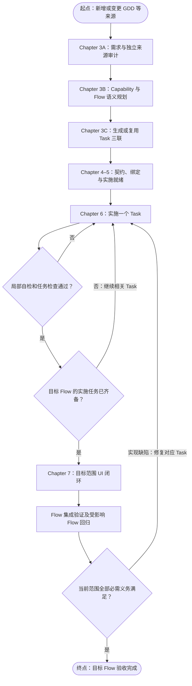

# newrouge B 路线工作流改造原始需求

- 文档日期：2026-11-02
- 修订日期：2026-11-03
- 文档用途：作为 bmad-prd 的原始需求输入，供后续 PRD、设计和实施规划追溯。
- 需求状态：用户已确认采用 B 路线，并接受前序讨论中的迁移建议；本文将这些决定整理为可分析、可验收的需求。
- 改造对象：newrouge 的 Chapter 3–7、Capability/MVG 规划、Task 三联、知识库消费及相关验证与恢复机制。
- 技术基线：Windows-only、Godot 4.5.1、C#；本期不以引擎升级作为前置条件。
- 现状核对基线：`fix/mvg-evidence-transport`，提交 `a8a363aa5f4ad09d5032731b0e7dfc5a17b8c89b`。
- 2026-11-02 核对的 main：`8f93557d7f5f07b7931e3f4966a2dce04e458344`。二者不同，不得把工作分支能力描述为已经进入 main。
- 本文中的需求 ID 用于原始需求追溯，不是已创建的 Task ID。本文不代表代码已改造或运行验收已通过。

## 1. 目标与核心决定

将 newrouge 的新增需求规划主路线，从“先定 Task、再规划 Capability/MVG Flow”调整为“先明确需求和 Capability/MVG Flow，再生成或复用 Task”。

保留完整 Task 体系、任务三联、Chapter 实施机制及现有质量底线。以 MVG Flow 组织一轮可交付玩法范围，以 Task 组织具体实施与局部自检，以明确的规则、状态、命令、交接和绑定定义约束 Agent。

本次改造要解决三个实际问题：

1. 在 Task 已稳定、Overlay/Contract 已建立后，才发现跨场景交接或验证责任缺口，导致多处返工。
2. Agent 缺少持久、版本明确的实施依据，需要反复解释 GDD，恢复执行或重复规划时容易改变拆分和实施范围。
3. 知识库虽然能展示关联，但这些关联未必能够作为实施入口的强约束，也不能单凭页面关系证明玩法已实现或已通过运行验证。

本次成功的结果应是：一个新的玩法切片能够先形成完整、可审阅的 Flow 规划，再形成稳定 Task；Agent 按已绑定定义实施；局部检查与 Flow 集成验证各负其责；重试、恢复和增量变更不破坏已有任务及累计回归基线。

### 1.1 术语边界

| 术语 | 本文含义 |
| --- | --- |
| A 路线 | 先形成 Task，再分析 Capability/MVG Flow 并匹配、补齐任务 |
| B 路线 | 先形成需求和 Capability/MVG Flow 的语义规划，再据此生成或复用 Task |
| 架构 Ⅲ 号路线 | 统一游戏模型进一步驱动生成、装配、解释执行或同步实现的架构方向 |
| MVG Flow | 有明确起点、终点、关键分支、状态交接和可观察结果的玩法链路 |
| Task | 持久的实施与责任承接单位，承接需求、Acceptance、依赖、实现范围和验证义务 |
| 四个实施部分 | 领域规则、C# 场景适配、绑定关系、场景实现 |
| 需求验收意图 | Task 拆分前即可说明的可观察结果和禁止出现的行为 |
| Task Acceptance | 由任务视图及 Chapter 5 管理、供具体 Task 实施和验证的验收要求 |
| Flow 集成验收义务 | 验证真实链路、交接及跨层结果的要求，由最终 manifest 和运行证据承接 |

A/B 仅表示规划顺序，不表示两个审核会话，也不等于现有 Semantic Projection A / Extraction B 的命名。本次 B 路线迁移为架构 Ⅲ 提供基础，但不等于本期完成通用游戏 DSL、运行时解释器或全量代码生成器。

## 2. 已核对的现状与改造依据

以下事实以本文固定工作分支提交为准。后续实施应重新确定起始基线，并分析变化，不得静默换用另一个分支的行为。

| 现有行为 | 对本次改造的含义 | 依据 |
| --- | --- | --- |
| Chapter 3 已有来源声明、Source Block Ledger、语义投影及守恒检查，然后形成任务三联 | B 应复用和调整这些能力，不能退回 Agent 直接自由解析 GDD 并写任务 | S1、S2 |
| Chapter 4 在有效任务三联基础上建立 Overlay/Contract；Chapter 5 做语义核对及 readiness | 保留实施前就绪机制，将不依赖 Task 的来源审计前移 | S2 |
| Capability 5.3、MVG 5.4 的正式规划依赖明确的 Chapter 5-ready Task scope | 需要解除前置语义规划对 Task/readiness 的循环依赖，不能只移动文档章节 | S3、S4 |
| MVG 结构要求 Task 归属；同时已经支持 planned 入口和测试 | 缺口是“无 Task 的正式语义规划”，不能误写为“现有系统完全不支持未来实现” | S4 |
| 任务归一化明确不让 Capability 决定成熟 Task 的身份和边界 | 新任务可受 Flow 指导；成熟任务身份保护仍须保留 | S5 |
| 没有匹配规划 trace 的 Task 可从现有义务检查返回 current | B 来源 Task 需要可靠的必需绑定识别，避免缺失绑定时被误判为无义务旧任务 | S6 |
| Knowledge/topology 属于派生视图；Capability/topology 的部分产物为本地可重建文件 | 被正式采纳并驱动 Task 的规划决定必须有持久版本依据，不能只依赖页面缓存 | S7 |
| MVG recommend 当前只调整相关测试的优先级，执行仍覆盖选定 manifest 的全部 required_tests | 不能把“相关优先”描述为已经支持按受影响 Flow 精确执行 | S8 |
| Chapter 6 已是单 Task 循环；Chapter 7 面向目标 backlog slice 的 UI 闭环 | 延续两者职责，提前规划 UI 义务，避免重复实施或等待整个项目完成 | S2 |
| 奖励页面仍通过字符串调用测试命名入口，并读取控制器内部状态 | 可作为四部分定义和生产接口约束的业务试点线索；不能据此宣称整个 Flow 已不正确 | S9、S10 |

本次原始需求依据源码与文档读取形成；这些现状说明不包含本轮 Godot 动态验收结论。

## 3. 已确认的设计原则

1. **B 是新需求的默认规划顺序。** 已完成、已稳定的 Task 不因采用 B 而整批重建。
2. **保留 newrouge 的完整 Task 体系。** 不将 ji-mu-yun 的轻量 Task 方案替换进本仓库。
3. **先定义可交付链路，再确定任务边界。** 前置到足以拆分和约束实施的程度，不要求先完成所有算法、类设计、节点路径及视觉制作。
4. **同一 Flow 持续细化。** 前期语义规划与后期 Task/契约/测试绑定共享稳定身份，不维护两套互不关联的 Flow 规划。
5. **四个实施部分是职责划分。** 不要求每个 Flow 节点拆成四个 Task，也不要求每个 Task 同时修改四部分。
6. **允许多对多关系。** 一个 Task 可以支撑多个 Flow；一个 Flow 可以跨多个 Capability；共享规则和状态定义应引用复用。
7. **保留两层验证。** Task 局部自检，以及 Flow 完成时的集成验收和受影响 Flow 回归。
8. **机器约束必须在真实消费者处执行。** 文档要求和页面提示不能替代 CLI、编译、绑定检查及执行入口的校验。
9. **沿用权威来源。** GDD/PRD 等来源管理需求语义，Taskmaster 管理任务状态，契约源码管理程序契约，运行报告证明实际执行。
10. **不以检查通过反向修改需求。** 不得通过删除义务、弱化断言、伪造入口或重分类范围来掩盖实现失败。
11. **恢复优先复用有效结果。** 不因会话中断、无关文件变化或重复点击而重新规划、分配身份或覆盖后续编辑。
12. **控制总交付成本。** 不为每个拓扑节点新增全套审批、全局扫描或 MVG 验收。

## 4. 范围与排除项

### 4.1 本期范围

- Chapter 3 内部规划顺序及其必要工具改造。
- Task 无关的来源语义审计、Capability 和 Flow 规划。
- 规划结果到任务三联、Overlay、Contract、Acceptance 和验证义务的承接。
- 四部分定义的结构化表达、阶段性完整性检查与 Agent 消费。
- Chapter 5 readiness、Chapter 6 入口及恢复、Chapter 7 UI 闭环的接入。
- Flow 集成验证、影响分析及共享变更的回归范围表达和执行。
- 稳定身份、增量迁移、持久采纳记录、重复应用及中断恢复。
- Knowledge/拓扑页面、规划操作页面、公共 CLI、相关 Skill、文档和测试的一致更新。
- 至少一个真实玩法切片的端到端试点，以及存量任务保护验证。

### 4.2 本期排除项

- 重建或重编号所有历史 Task、重新执行全部已完成任务。
- 新建第二套 Task 状态、独立 MVG 完成状态机或与现有 manifest 无关的验收体系。
- 通用游戏 DSL、统一运行时解释器、全量代码生成、全场景自动生成。
- 全仓 GDScript 到 C# 的一次性迁移；试点新增或调整的场景适配应遵守 C# 目标及明确的迁移边界。
- 游戏玩法重设计、数值平衡调整、美术重制或全部场景重做。
- ji-mu-yun 平台迁移、用户沙箱、平台认证、多租户与其他控制面工程。
- Unity、移动端、Web 游戏或多人在线支持；当前保持 Windows、Godot 4.x、C#。
- 以本次迁移为由升级引擎、修改分支保护、降低现有 P1 必修底线或删除有效回归。
- 将 newrouge 的完成标准强制改成“任意游戏两小时交付”。2–3 小时目标属于 ji-mu-yun 原型讨论，不能直接转化为本工程承诺。
- 自动运行 bmad-prd 或后续实施工作流；本文是其输入。

## 5. 目标 Chapter 顺序

“3A/3B/3C”是本需求对 Chapter 3 内部职责的标识，不是当前已经存在的命令，也不强制实施时新增三个公共命令。

| 阶段 | 主要职责 | 进入下一阶段的依据 |
| --- | --- | --- |
| Chapter 3A | 来源注册、完整 Ledger、Requirement、需求验收意图；完成或复用 Task 无关的独立来源审计 | 来源已完整记账，相关语义冲突和缺失已处理，当前输入身份明确 |
| Chapter 3B | Capability 与 MVG Flow 的 Task 无关语义规划；四部分职责及交接定义；非 Flow 需求明确其他验证去向 | 适用的语义边界与验证目标明确；玩法 Flow 的起终点、分支和状态责任完整；采纳结果持久化 |
| Chapter 3C | 根据实际实施缺口生成或复用 Task；预览并编译任务三联 | 任务身份、需求映射、适用的 Flow 或其他验证责任及初步依赖一致 |
| Chapter 4 | 细化 Overlay、契约、状态所有者、C# 适配、绑定和场景约束 | 目标范围具有可实施的具体契约和责任边界 |
| Chapter 5 | 核对 Task Acceptance、依赖、覆盖和适用的四部分绑定；形成最终验证义务与当前 readiness | 输入一致、责任闭合；规划、Task 及适用验证义务绑定有效 |
| Chapter 6 | 单 Task 实施、自检、评审、修复和恢复 | 当前 Task 的局部义务满足，相关证据有效 |
| Chapter 7 | 目标 Flow 对应 backlog slice 的 UI 闭环确认 | 关键界面和输入连接满足已规划义务，无遗漏或重复创建 |
| MVG 收尾 | 目标 Flow 完整验证、受影响 Flow 回归；适用时执行累计里程碑验收 | 当前整合快照上的必需运行证据及人工义务满足 |

图示针对新增或变更玩法 Flow。合法非 Flow 需求仍经过来源记账、语义审计和验证去向确认，再生成或复用 Task，进入适用的 Chapter 4–6 检查；不为符合图示而创建虚构 Flow。没有 UI 义务时不强制执行 Chapter 7；是否需要 MVG 回归按实际影响判断，不由“非 Flow”标签自动豁免。

图中的失败回路表示实现缺陷。对于不改变已采纳定义的局部修复，可复用现有规划，从对应 Task 的实施与自检继续，具体见 BR-09。若发现需求、契约或规划错误，应返回拥有该定义的阶段，形成明确变更并更新受影响绑定；不得让 Chapter 6 自行改写上游定义。里程碑完成还须满足累计范围要求，单条 Flow 完成不自动等于整个里程碑完成。

## 6. 四部分定义与权威关系

### 6.1 四部分分别需要说明什么

| 部分 | Task 拆分前必须明确 | Chapter 6 前应细化到的程度 | 对实施的约束 |
| --- | --- | --- | --- |
| 领域规则 | 业务结果、前后条件、状态所有者、允许动作、关键不变量和失败行为 | 命令、只读状态、契约、状态迁移及关键边界可供实现和测试 | 领域状态通过规定入口变更，UI 不直接改内部状态 |
| C# 场景适配 | 输入如何提交动作、读取什么状态、承担哪些反馈和展示职责 | 对应适配边界、生命周期、依赖及所承担的展示/反馈义务 | 新增适配按 C# 目标实现；领域判断不分散复制到 UI |
| 绑定关系 | 逻辑控件、命令、视图状态及主要交接的对应关系 | 绑定对象/资源引用、类型和生命周期约束明确；待建对象标明 planned | 缺失、错配、失效连接能够被检查，不能仅靠 Agent 自觉 |
| 场景实现 | 进入/退出场景、必要视图、视觉资源和布局职责 | 场景/资源范围及受管部分明确，允许保留人工制作区域 | Godot 原生场景和资源保留布局、美术、动画制作空间 |

“玩法规则与绑定定义”是上述实施的定义依据，不等于四部分已经实现。前置规划可使用逻辑标识和 planned 对象；不得为通过前置检查创建无功能的假节点、假接口或假 Task。

涉及多个 Flow 的共享规则、命令、状态和资源，应引用同一受治理定义。Flow 定义描述如何组合这些能力；不能复制一份规则正文后各自修改。

需求覆盖归属与共享依赖引用应分别表达。保留现有每条 Requirement 的单一覆盖归属规则；允许多个 Flow 依赖同一能力或定义，并验证各自的交接，不能通过重复声明 Requirement 覆盖归属来表示共享。

四部分在 Flow 层面应完整说明。在 Task 层面可以只涉及其中一部分；不适用项应有明确理由，不制造无意义占位实现。

### 6.2 权威与投影

| 对象 | 权威或用途 |
| --- | --- |
| 原始 GDD/PRD、批准变更、适用 ADR | 需求语义及范围、约束依据 |
| Source Block、Requirement | 对来源的稳定定位和规范化投影，保留回链 |
| 已采纳 Capability/Flow 规划及非 Flow 验证去向记录 | 当前任务拆分、交接和验证适用性的版本化依据；受原始来源约束 |
| `tasks_back.json`、`tasks_gameplay.json` | 可审阅的业务任务视图及其受治理字段 |
| `tasks.json` | Taskmaster 编译视图及唯一任务状态权威 |
| `Game.Core/Contracts/**` | 程序契约源码权威，保持 BCL-only |
| MVG manifest | 累计测试范围、责任及验证义务；不充当游戏运行时状态机 |
| Knowledge 页面和拓扑索引 | 只读导航、定位和证据展示，可重建；不独立决定完成 |
| 原始运行报告及其身份绑定 | 证明对应输入和快照上实际运行的结果 |

正式采纳规划的持久化，不意味着所有派生图文件都提升为需求语义权威。版本化保存哪些最小规划记录、哪些内容留作日志/索引，由后续设计明确。

本次工作流改造不要求发布后的游戏读取 Taskmaster、Knowledge 页面或 Chapter 规划记录才能运行。

## 7. 功能需求

### BR-01 来源完整记账与需求承接

沿用累计来源注册和完整 Source Block Ledger。所有声明来源必须可解析、可定位，分批读取不得静默截断。每个来源块均有语义投影或明确去向。

先产生 Requirement 和需求验收意图，再生成 Task。未进入当前 Flow 的需求仍须保留累计去向，例如其他 Flow、共享约束、其他验证、待实施范围或有依据的延期/范围外决定；不得因没有 Task 而丢失。

需求覆盖不以 Task 数、Capability 数或图节点数作为充分条件。

### BR-02 Task 无关的独立来源审计

将现有 Chapter 5.0 中不依赖 Task 的来源独立提取、遗漏和冲突核对前移到 Chapter 3A。独立审计仍从完整来源及 Ledger 确定范围，不能由第一轮 Requirement、Task 引用或已选 Flow 反向裁剪原始输入。

Chapter 5 保留 Task、Acceptance、契约及绑定核对，并复用有效来源审计。来源、解析器或相关审计输入发生变化时，更新真正受影响的审计范围及证据；不能只刷新旧 readiness 的时间戳。

### BR-03 无 Task 的正式 Capability 与 Flow 规划

应能在目标范围尚未生成任何 Task、尚无 Chapter 5 Task readiness 时，正式完成语义规划、审阅和采纳。

规划输入以来源、Requirement、已有受治理能力、架构约束及现有实现证据为依据。已有 Task 可以辅助判断复用，不得成为新建规划的必需存在条件。

不得通过虚构 Task、占位 readiness 或 `allow_unready_draft` 绕过正式要求。前置“规划可采纳”与后续“Task 可实施”应有不同的检查内容，不能混用通过结论。

Capability 不新增任务状态或完成状态。对不适合按玩法分组的全局约束、治理或工具链需求，允许采用有依据的其他验证去向，不强造 Capability 或玩家 Flow。正式采纳记录须说明其适用性、来源理由和验证责任；合法非 Flow 任务与“缺失 Flow 绑定”必须可区分。

### BR-04 Flow 语义及四部分结构

每条目标 Flow 应表达：稳定身份、来源和 Requirement 引用、起点和进入条件、成功终点、必要的失败/取消/返回分支、关键交接、状态所有者、可观察结果及验证目标。

四部分职责应能被机器读取和检查。业务拓扑节点表示行为或交接，不等同于 Task，也不等同于场景树节点。

允许合法的重入、重试和玩法循环；不能把所有游戏行为强行建成无环图。需要同时检查必要的可达性和退出条件，具体可判定范围由设计说明。

### BR-05 规划采纳记录与稳定身份

正式采纳的规划必须具有持久的版本、来源绑定、内容身份及采纳依据，足以跨会话恢复、审阅差异并支撑任务生成。

前置 Flow 与后续 manifest/Task 绑定保留同一 Flow 身份，不能在 Chapter 5 再生成一套无关联 Flow。同一已采纳输入恢复执行时，应复用有效规划，不重新解释 GDD。

显式重新规划可以改变设计，但必须形成可审阅差异和身份对齐；不得把模型文本完全一致视为稳定性的前提。

### BR-06 根据实施缺口生成或复用 Task 三联

Task 规划应同时考虑目标 Flow 或已确认的非 Flow 验证去向、适用的四部分责任、已有实现、已完成 Task、共享能力和验证义务。

先判断可复用内容，再生成实际缺口对应的 Task。允许一个 Task 支持多个 Flow、一个 Flow 由多个 Task 完成，不强制一节点一 Task 或四部分各一 Task。

保留现有视图生成、审阅、编译任务三联的受治理路径，不让 Agent 直接随意写 `tasks.json`。Task 必须能够追溯 Requirement、Acceptance、依赖、实现责任和验证义务；适用时关联 Flow，不适用时关联已采纳的非 Flow 验证去向及理由。

Task 拆分应支持独立实施与局部验证，不设置未经实测的固定任务时长或固定任务数量。

### BR-07 分阶段细化契约与实现绑定

Chapter 3B 使用业务角色和逻辑边界表达交接；Chapter 3C 绑定实施 Task；Chapter 4–5 细化程序契约、生产入口、只读状态、场景/资源和测试责任。

不得要求前置语义规划已有实际 Task ID、完整代码符号或已创建场景。进入实施前必须具备足够明确的实现义务； planned 资源可尚未存在，但不能被宣称已实现。

检查应覆盖引用合法性、状态所有者、命令和只读状态边界、四部分责任及交接遗漏。真实对象存在后，增加类型、编译、绑定和引擎级检查。结构检查不能冒充业务语义审阅或运行证明。

### BR-08 Chapter 5 就绪与最终义务绑定

Chapter 5 应核对当前 Task Acceptance 与 Requirement、适用的 Flow 或其他验证去向、ADR、Overlay、Contract 及测试义务的一致性，处理遗漏、重复责任、依赖错误和交接无人承担。

本次 B 流程处理的 Task，其来源、实施依据、readiness、所用规划或验证去向记录、任务义务必须能核对为同一组有效输入。在满足这些共同条件后，按下表核对验证适用性：

| 适用情况 | 必需绑定与入口行为 |
| --- | --- |
| 归属 Flow，或承担 MVG 交接、集成验证、回归义务 | 必须有对应的有效 manifest 绑定；缺失或过期时拒绝实施。非 Flow 任务若影响已有 Flow，也须承接实际产生的 MVG 回归义务 |
| 合法非 Flow 任务，且当前确无 MVG 义务 | 必须有已采纳的适用性依据和其他验证义务；两者有效时可进入实施，不要求创建 Flow 或 manifest 归属 |
| 无法判断适用性，或依据缺失、损坏、过期、来源不明 | 拒绝实施并报告缺口；不能把空字段或 Agent 自行填写的“不适用”当作合法豁免 |

任务类型标签本身不能决定是否豁免 MVG 绑定；须结合当前有效定义和实际影响判断。未纳入本次迁移的存量 A 路线任务继续遵守 BR-14 的既有适用边界。

上游语义或相关绑定变化，应使受影响 readiness 失效；无关变化不应强制全仓重做。

进入 Chapter 6 的 readiness 不要求待实施 Task 已完成，避免“必须实现后才能进入实施”的循环。运行验收时再检查实际实现和相关前置完成条件。

### BR-09 Chapter 6 消费约束与局部修复

保留 `run-single-task-chapter6` 及现有单 Task 实施、TDD/检查、评审、Needs Fix、pre-commit 和恢复机制，遵守当前质量底线。

B 来源 Task 必须显式消费有效的来源、实施依据、readiness 及适用验证义务。是否需要 manifest 绑定，依据当前有效规划、验证去向记录和实际影响判断。缺失、损坏、过期或来源不明时，不能静默落入“无适用义务”的旧路径，也不能仅凭 Agent 填写“不适用”放行。公共 CLI、直接实施入口、恢复入口和页面触发应使用一致规则。

Agent 发现上游定义不足时，应形成明确缺口，返回对应定义阶段；实现阶段不能私自弱化 Acceptance、修改状态所有权或绕过绑定。局部自检按有意义的实现单元运行，不按每个按钮、图节点或代码编辑启动完整 MVG。

对不改变已采纳玩法定义、程序契约、状态所有权、交接/绑定设计和验收义务的局部实现缺陷，复用当前有效规划，通过相应 Task 实施、自检，并按影响执行已有 Flow 回归，不重新运行整套 Chapter 3A/3B 规划。若需要新建修复 Task，仅补充必要的任务映射、受影响核对及 readiness，保留旧任务完成历史；不得以“局部修复”为由跳过必要就绪检查。若修复实际需要改变上述定义，返回拥有该定义的阶段处理。

### BR-10 Chapter 7 的 UI 义务提前承接

UI、输入、动画反馈、场景入口和返回条件，应在 Flow 与四部分规划中提前声明。相关代码和场景工作可作为 Chapter 6 Task 实施。

Chapter 7 仍负责目标 backlog slice 的 UI 闭环确认与遗漏修复，不等待整个游戏所有 Task 完成，也不为已实现且已验证的相同义务重复创建 Task。

发现真正缺口时，通过既有受治理任务路径补齐。真实引擎输入、场景方法调用和静态接线检查必须分别表达，不能相互冒充。

### BR-11 两层验证与真实运行证据

保留两套职责清晰、可共享工具和构建资源的验证机制：

- Task 局部自检：验证该 Task 的规则、接口、绑定和受影响局部行为。
- Flow 集成验证：在目标链路实施齐备后，验证真实输入、跨层交接、状态变化和最终结果。

Flow 完成必须满足其全部必需义务；局部测试通过不能自动推导 Flow 完成。规划检查通过、场景关联存在、测试条目为 planned、未运行/跳过/空报告都不能当作运行通过。

合法非 Flow 任务按其已采纳的其他验证义务完成；若影响已有 Flow，仍须满足对应回归要求。视觉、手感等人工义务应按范围保留，不由机器报告替代。两层职责不要求建设两套重复测试框架或服务。

### BR-12 受影响 Flow 回归与范围真实性

共享状态、命令、契约、适配、场景资源或测试基础设施发生变化时，应识别并记录所有受影响 Flow 及其验证义务。范围应包含必要的传递依赖，不能只检查提出修改的 Flow，也不能因 Flow 尚未实现而不登记影响。

运行回归与尚未实现的交付义务应分别处理：

| 对象 | 必需处理 | 完成声明的边界 |
| --- | --- | --- |
| 已有、受影响的可运行 Flow，以及因本次变更而失效的既有 Flow | 执行受影响范围内完整的既有必需回归义务；因本次变更无法启动或执行失败时，应修复后验证 | 失败或无法运行不能改记为范围外 planned；既有回归通过不能替代本次新增义务 |
| 本次交付范围内尚未完成的 Flow 或新增义务 | 保留并完成实施与验证；未完成前保持 pending/blocked 的证据状态 | 阻断本次范围完成，不得作为已通过结果 |
| 已规划但尚未实现、且有依据不属于本次交付范围的 Flow 或义务 | 更新影响记录、定义/绑定及后续验证责任 | 不要求为本次回归立即实现，但不能宣称其已验证，也不得从后续累计验收中遗漏 |

同一 Flow 可以同时有既有回归和本次新增义务。已有代码或场景可运行，不代表其全部当前义务已完成。延续现有 `required_regressions`、`planned_tests` 和人工义务的区分；这些是验证职责，不新增 Task 状态机。[S11]

本次交付范围须由有效来源和采纳计划确定。不得将既有必需测试重标为 planned、将失败 Flow 移出范围，或仅按实现状态过滤清单来获取通过。合法范围调整仍须遵守 BR-14 的变更与防削弱规则。

系统应产生可审阅、可执行的回归集合，并列明本次必需但尚未可执行的义务、后续范围义务及各自依据。允许保守执行更大范围；未知映射或无法判断影响时，扩大到适用累计范围，按上述分类核对和处置全部义务，不能以“未找到关系”推断无影响。若无法确认本次范围内全部必需义务已满足，则不得报告本次交付完成。

累计规划可以包含 planned 对象，但它们不能冒充可执行回归。执行范围及结果必须绑定当前有效计划、累计基线和适用义务；不能靠选取旧 manifest 版本遗漏本次新增要求。如果实施选择性执行，执行器须真实消费该范围，并输出实际执行、待完成和覆盖信息；只调整顺序不能宣称实现了选择性回归。

普通 Flow 收尾和累计里程碑收尾应明确区分。critical 子集、单条 Flow 或 partial 结果不能被标记为整个里程碑的 full-MVG 通过。里程碑收尾继续遵守累计 manifest 的全部适用要求。

### BR-13 重试幂等、恢复与证据复用

以下能力必须分别设计和验证：

1. 规划稳定：复用已采纳计划及稳定身份，不因恢复重新拆分。
2. 应用幂等：同一操作身份和相同内容重复执行，不重复创建任务、重复施加 delta 或重复覆盖文件。
3. 证据复用：完整相关输入和验证规则未变时，复用有效证据，而非只看 Git HEAD。

应用操作应有持久记录与明确恢复点。中断后须核对已落地结果；同一操作身份绑定不同内容、证据损坏或发生后续人工编辑时，应报告冲突，不能盲目重放。

复用身份应包括适用来源、采纳规划、Task/契约/绑定、验证规则及相关依赖；工具链和环境在影响结果时也应纳入。不得只以任务 ID、文件名或单个切片正文哈希推断全部有效。

本需求不降低最终 MVG 对同一整合快照的运行证据要求，不把多个不一致快照的报告拼成一次通过。

### BR-14 存量保护与累计基线演进

新需求默认按 B 进入；成熟 Task 的 ID、状态、历史依据和已完成成果保留。更新、拆分、合并、退役必须有明确差异和依据，不接受候选默认值覆盖旧状态。

旧 Flow 和测试继续纳入累计 manifest。删除、退役或降低义务必须沿用既有防削弱要求，不能借迁移清空旧基线。

历史完成状态应保留，但若当前义务发生变化，应通过变更任务或明确更新处理，不能用旧 done 状态证明新义务已通过。

已有 A 路线任务可在明确适用边界内继续执行；B 来源任务不能通过丢失来源标识变成 legacy。过渡兼容要有收敛条件，不永久维护两套互相矛盾的规划真相。

### BR-15 Knowledge 与操作入口一致接入

Knowledge 应展示来源、Requirement、Capability、Flow、四部分定义、Task、契约、场景和验证义务的可追溯关系，并能定位当前缺口及受影响范围。

必须区分计划关系、已落地实现和实际运行验证。工作分支/工作区预览、attempt、stable、main 发布视图不得混淆；预览不能越权更新 current/last-known-good。

规划页面和公共 CLI 应支持 B 的先规划后任务流程，展示真实阶段、阻塞原因和可恢复位置，不再把 Task readiness 作为所有规划的统一入口条件。

Chapter 6 延续不隐式执行全局 Knowledge refresh 的边界。Agent 消费的应是明确绑定的定义及证据，而不是页面摘要或重新扫描后的不确定上下文。

### BR-16 有界输入、预算和失败处理

保留有效的输入完整性检查、隔离分析、独立语义核对、候选采纳与失败预算机制。调整发生阶段，不借迁移默认取消现有审阅保护。

大 GDD、长报告和多 Flow 处理应支持有界批次和完整性证明；不通过截断来源或丢失义务降低成本。已经成功且输入未变的阶段应复用，不因下游失败重新支付全部候选生成成本。

记录规划、Task 生成、局部验证、Flow 验证和修复的耗时、调用量及复用情况。无确定性进展时停止无效重试，并保留可恢复原因。

### BR-17 消费者、文档与格式迁移完整

应覆盖来源/规划生产者、Task 三联生成与编译、Chapter 4/5、Chapter 6/7、manifest 校验与执行、Knowledge/规划页面、CLI、Skill 和相关测试，不以只改 `workflow.md` 作为完成。

新旧格式必须可识别。损坏或未知版本不能当作合法缺失；需要迁移时应明确输入、输出、身份保留及恢复方式。

更新 AGENTS 路由、阶段文档、公共入口说明和示例，使其指向同一实际流程。最终保留必要的版本化规划依据、定义与迁移说明；原始运行日志仍按仓库规则管理，不要求把所有过程日志提交到 Git。

### BR-18 真实切片试点与迁移证明

至少验证两条路径：无现成 Task 的新规划路径，以及保留旧 Task/旧 Flow 的增量路径。测试应覆盖成功、中断恢复、输入漂移和缺失义务等关键反例。

优先以 `combat-reward-return` 作为存量迁移与真实消费者试点。沿用已有 Flow 身份及其责任映射；现有任务编号仅作为实际复用对象，不因本需求重新分配。

同时应有一个明确的新增或变更玩法切片，通过 B 产生真实实施任务并走通 Chapter 4–7 与适用 MVG 验证。仅导入旧关系、生成图或通过 schema 检查不足以证明新路线可用。

PRD 应确定试点的最小实际业务改动。奖励页面的生产命令、只读状态和 C# 适配可作为候选；不得把它自动扩大为整个游戏重构。

## 8. 验证时机与复用规则

| 时机 | 应做的检查 | 不应默认重复的工作 |
| --- | --- | --- |
| 来源或规划变化 | 受影响语义、覆盖、身份及结构检查；必要的独立审阅 | 未变化来源和有效采纳结果的全量重生成 |
| 一个 Task 的有意义实现单元完成 | 领域/适配/绑定局部检查及必要测试 | 每个拓扑节点都运行整套 Flow 验收 |
| Task 完成或恢复 | 当前 Task Acceptance、readiness、适用验证义务绑定及既有 Chapter 6 检查 | 全局 Knowledge 重建；为合法非 Flow 任务虚构 MVG 归属 |
| 不改变已采纳定义的局部实现修复 | 复用有效规划，补齐必要任务映射与 readiness，运行局部检查和适用回归 | 整套 Chapter 3A/3B 重新规划 |
| 目标 Flow 实施及 UI 齐备 | 该 Flow 全部当前必需集成义务及适用人工检查 | 无依据扩大到所有历史项目范围 |
| 共享部分变更 | 登记全部受影响 Flow；执行既有必需回归，核对本次新增义务，保留范围外未实现义务的后续责任，具体见 BR-12 | 对同一快照重复构建/预热/执行相同测试；为运行回归强制提前实现范围外 Flow |
| 里程碑收尾 | 当前累计必测范围与本轮组合测试的同一整合快照证据 | 把局部绿色结果改写为累计 full-MVG 通过 |

影响分析可以随变更更新，但相关 Flow 回归可在一次有意义的变更批次或收尾时集中执行，不要求每次保存文件立即运行。

同一份共享测试结果只有在输入、快照、测试身份和验证语义均匹配时，才可被多个 Flow 引用。共享构建和预热不等于共享可变运行状态，各测试仍需必要隔离。

## 9. 奖励 Flow 示例

`combat-reward-return` 的目标可概括为：战斗结束后进入路由所属奖励流程，奖励 offer 保持稳定，领取或跳过按规则更新状态，最后通过规定路由返回，避免重复写回。现有 manifest 已包含对应责任及测试映射，属于复用基线。[S9]

| 部分 | 示例定义 |
| --- | --- |
| 领域规则 | 奖励内容、领取前提、offer 稳定性、领取/跳过后的状态更新、重复提交行为、返回条件 |
| C# 场景适配 | 将玩家输入提交到生产命令，读取只读状态，驱动展示、禁用状态、动画和反馈 |
| 绑定关系 | 领取/跳过控件对应何种命令；奖励列表、已领取状态和返回按钮显示何种只读状态 |
| 场景实现 | 保留奖励页面原生布局、素材、动画和节点组织，明确受管连接和人工视觉制作范围 |

生产玩家行为与自动验证应使用同一真实业务命令入口。只读状态用于展示和诊断，不能作为测试直接修改业务状态的后门；测试初始化可通过明确的 fixture 隔离管理，不冒充玩家操作。

现有 `RewardScene.gd` 会寻找具有 `ResolveRewardForTest` 的控制器、以字符串调用该入口，并读取 `_reward_selection_state_by_context`。[S10] 若 PRD 选择该处作为实际业务试点，应将这些依赖收敛到明确的生产命令和只读接口，再完成必要的 C# 场景适配与原生场景绑定。

接口名称、类名和具体生成方式由后续设计确定。一个需求可以同时涉及领域与适配，一个共享命令也可以支撑多个 Flow；不依据示例机械生成固定数量 Task。

## 10. 改造验收场景

以下是本次工作流改造的验收要求，供 PRD 细化。它们不替代游戏本身的 Requirement、Task Acceptance 或 Flow 测试。

| 编号 | 场景与预期结果 | 对应需求 |
| --- | --- | --- |
| AC-BR-01 | 在无现成 Task/readiness 的目标范围，能够从有效来源完成正式 Capability/Flow 规划与采纳，随后生成 Task；过程中无假 Task、假 readiness | BR-01–03、06 |
| AC-BR-02 | 原始来源含未被首轮投影覆盖的交接要求时，独立审计能够发现；不能因 Task 或 Flow 未引用该段而跳过 | BR-01、02 |
| AC-BR-03 | Flow 的起终点、关键分支、状态归属和四部分职责可解析、可回链；合法循环和明确不适用项不被机械拒绝 | BR-04、07 |
| AC-BR-04 | 前置 Flow 细化为 Task/契约/测试绑定后保持身份；planned 对象在适用阶段合法，但不会被展示为已实现或运行通过 | BR-05、07、08、15 |
| AC-BR-05 | 一个共享 Task 支撑两个 Flow，四部分并非固定拆成四个 Task；责任完整，且共享引用不会形成重复的 Requirement 覆盖归属 | BR-04、06、07 |
| AC-BR-06 | 无输入变化的恢复或重复应用保留 Task/Flow 身份与有效结果，不重复创建或重复施加 delta；显式重新规划有差异记录 | BR-05、13 |
| AC-BR-07 | 在多产物应用中断后，可识别已完成写入并恢复；若存在后续编辑或同操作身份内容冲突，不覆盖、不伪报成功 | BR-13 |
| AC-BR-08 | B 来源 Task 缺失或使用过期来源、实施依据、readiness 或适用义务绑定时，各实施/恢复/页面入口均拒绝；适用 MVG 的 Task 删除 manifest 绑定或无依据改为“不适用”也被拒绝 | BR-08、09、15 |
| AC-BR-09 | 无关输入变化复用有效局部证据；相关来源、契约或验证规则变化使受影响证据失效；损坏证据不会被当成未发生变更 | BR-08、13、16 |
| AC-BR-10 | Task 局部自检可独立执行；一个小节点完成不自动启动全套 MVG；目标 Flow 收尾时执行全部必需义务 | BR-09、11 |
| AC-BR-11 | 共享命令或状态变化时，全部受影响 Flow 被登记；既有必需回归完整执行，本次新增义务与后续范围义务分别列明；未知关系触发保守扩大后，仍按这三类处置，不把范围外 planned 义务直接当作可执行回归；声明范围与实际证据一致 | BR-12 |
| AC-BR-12 | 关键 UI 链路以真实引擎输入验证；人为断开必要绑定等反例能使对应检查失败；空报告、跳过、静态连接不被当作运行通过 | BR-07、10、11 |
| AC-BR-13 | 已在 Chapter 6 完成的 UI 义务进入 Chapter 7 时被复用，不重复创建同义任务；新发现缺口通过受治理路径补齐 | BR-10 |
| AC-BR-14 | 旧任务 ID/状态、未受影响定义和累计测试保留；无依据移除旧 Flow/test 或降低义务的 delta 被拒绝 | BR-14 |
| AC-BR-15 | 历史 done 任务遇到新义务时，不被自动解释为新义务已验证；旧任务适用范围与 B 绑定要求可区分 | BR-08、14 |
| AC-BR-16 | 规划页、CLI、Skill、文档和实际入口一致；Knowledge 区分计划、实现、运行证据及分支/预览身份，不污染已发布视图 | BR-15、17 |
| AC-BR-17 | 构建/预热和相同测试可按有效条件复用，各 Flow 的证据引用真实；最终累计通过不由不一致快照的报告拼接 | BR-11–13 |
| AC-BR-18 | 以实际玩法切片走通 B 的完整链路，并验证已有 Flow 的增量迁移；Windows/Godot/C# 相关运行结果有对应原始证据 | BR-18 |
| AC-BR-19 | 新旧格式、合法缺失、损坏和未知版本有可验证行为；迁移不借兼容路径绕过 B 的必需义务 | BR-09、14、17 |
| AC-BR-20 | 对可比切片记录阶段耗时、模型调用、复用、重复测试和修复成本；数据足以判断是否减少返工，而非只宣称更快 | BR-16、18 |
| AC-BR-21 | 一个合法非 Flow 治理 Task 具有有效来源、实施依据、适用性依据、其他验证义务及 readiness，且没有 MVG 义务时，能进入实施而不创建假 Flow；删除适用性依据或其他验证义务后，各实施入口均拒绝；若实际影响已有 Flow，其回归义务仍须绑定并验证 | BR-03、06、08、09、11 |
| AC-BR-22 | 共享变更影响已有 Flow A 和范围外未实现 Flow B：A 完整回归，即使因本次改动无法启动，也必须修复并验证；B 的影响及后续义务保留且不宣称通过；若 B 纳入本次范围，其未完成义务阻断本次完成；不得重分类既有测试或失败 Flow 绕过此要求 | BR-12、14 |
| AC-BR-23 | 不改变已采纳定义的局部缺陷复用现有规划，经相应 Task、必要 readiness、自检及适用回归完成，不重跑整套来源/Flow 规划；若修复触及定义或契约，则返回对应定义阶段 | BR-05、08、09、13 |

现有仅因 owner 承担集成测试而存在的任务，不应被新增完成条件造成自依赖死锁；原有 producer/consumer/owner 的适用差异应在测试中保持。

## 11. 非功能与工程约束

- **可追溯性：** 每个正式实施义务能定位到当前版本的来源、规划、Task 和验证依据；摘要和页面链接不能替代原始依据。
- **恢复可靠性：** 中断和重试可解释，保留最小必要的持久操作记录，不依赖单次模型记忆。
- **输入完整性：** 大输入分批处理，跨批次引用及共享义务仍可核对；不以静默截断换取成功。
- **可维护性：** 复用现有 Chapter 和公共入口，避免复制整套旧流程；格式和迁移边界明确。
- **性能：** 优先减少重复解析、无关失效、重复模型调用与引擎预热；不以降低验收要求换取耗时指标。
- **平台：** 面向仓库当前 Windows/Godot/C# 环境设计与验证；领域和契约保持 BCL-only，原生场景保持可编辑。
- **实施权限：** 业务 Agent 通过规定命令和定义工作；校验不能仅依赖同一 Agent 的“已完成”声明。无需为本次工作流迁移扩展为新的多租户安全平台。
- **语言与文件：** 遵守仓库 UTF-8、中文沟通及现有代码/脚本/测试英文约定。
- **证据管理：** 继承仓库日志规则；最终可复现定义与过程证据分别管理，避免把所有运行日志作为版本化源文件。

不承诺每个 Task 固定在某分钟数内完成。应比较“完成一条可比 Flow 的总成本”，并区分一次性迁移成本、正常规划成本、实施成本与返工成本。

## 12. 建议迁移顺序与回退边界

以下是供 PRD 细化的依赖顺序，不是已经生成的实施 Task 清单。

1. **基线与消费者盘点。** 固定实施提交，核对本文基线差异；识别来源、规划、Task、readiness、manifest、页面及恢复消费者。
2. **前置规划基础。** 建立 Task 无关审计和 Flow 语义表达、持久采纳及身份规则；验证无 Task 的正式路径。
3. **Task 与 Chapter 接入。** 从采纳规划生成/复用任务三联，接入 Chapter 4–6 的绑定和就绪约束，再处理 Chapter 7 义务复用。
4. **验证与操作面接入。** 完成真实执行范围、影响回归、Knowledge/页面/CLI/Skill 一致性和关键恢复反例。
5. **真实切片试点与增量启用。** 验证新建和增量两条路径，再将新需求默认入口切换为 B；旧任务按明确边界逐步承接。

迁移写入必须能预览差异并保留恢复依据。回退不得抹除后续人工修改，也不得将已采纳的 B 任务伪装成无绑定旧任务。保留旧路线仅服务于明确存量范围，退出条件应在设计中说明。

## 13. PRD 与后续设计的职责

B 方向及本需求的范围约束已经确认，无需重新询问。PRD 应确定产品行为、范围、阶段责任和可观察验收条件；具体数据结构、算法、文件组织和实现方案由后续 SPEC/Architecture 细化，并保持追溯。

### 13.1 PRD 应明确

1. 哪些新增玩法、增量变更、非 Flow 需求和局部修复适用哪些已有阶段；哪些定义必须重新核对，哪些有效结果可以复用。
2. 前置语义规划到 Task 实施的可观察交接条件；合法“不适用”、必需绑定缺失和过期证据应产生何种结果。
3. 既有回归、本次新增义务、范围外待实施义务的处置和完成边界，保持累计验收及防削弱要求。
4. 四部分定义需要约束的行为和可检查结果，以及 planned 内容何时必须完成；不要求 PRD 固定字段编码或检查器实现。
5. 重试、中断、冲突和输入漂移时的预期行为，明确不能重复创建、覆盖后续修改或错误复用证据。
6. 最小真实试点范围、各批次交付物、旧任务适用边界、迁移退出条件及性能衡量方法。试点若涉及奖励 C# 适配，应明确业务和场景改动范围。

### 13.2 留给 SPEC/Architecture 细化

| 设计事项 | 需实现的上游约束 |
| --- | --- |
| 语义规划、采纳记录、后置绑定的数据结构、字段、版本及文件组织 | 持久、可追溯，区分计划与实现，保护原始语义和 Task 状态权威 |
| 稳定身份、指纹及影响范围计算 | 有效结果可复用，相关变化会失效，无关变化不触发全量重做 |
| B 来源识别、验证适用性及门禁实现 | 合法非 Flow 任务可实施，必需义务不能因缺失字段或任意“不适用”声明而绕过 |
| 多产物应用、操作记录、冲突处理和恢复机制 | 重复应用不产生重复效果，中断可恢复，不覆盖后续编辑 |
| 生产者/消费者拆分、公共 CLI 参数及执行器扩展 | 实现 B 的顺序、范围真实性和既有入口一致性，不形成循环依赖 |

PRD 可引用技术可行性分析，但不将未经后续设计验证的具体算法、JSON 字段、类名或 CLI 参数当作已经批准的实现约束。SPEC/Architecture 需在既定行为和验收边界内给出方案；只有新发现的范围、权威或不可逆取舍需要用户决定，不能把常规实现选择全部转化为新增人工审批。

## 14. 交给 bmad-prd 的使用说明

将本文作为原始需求和已确认方向输入，并在 PRD 中保留 BR-01–BR-18 的追溯关系；拆分或合并表达时，应保留映射和范围。

建议随本文一并提供固定基线的 `AGENTS.md`、`workflow.md`、语义拓扑说明、MVG 验收说明和相关代码。bmad-prd 应区分：

- 已确认的用户目标与不可变约束。
- 当前仓库已经实现的能力。
- 本次必须新增或调整的能力。
- 需要 PRD 确定的产品行为、适用范围及实际试点范围。
- 留给 SPEC/Architecture 细化的数据结构、算法和实现方案。
- 本期排除项和后续架构 Ⅲ 能力。

可使用以下指令作为交接起点：

> 请基于《newrouge B 路线工作流改造原始需求》创建 PRD。用户已确认采用 B 路线：先完成需求及 Capability/MVG Flow 语义规划，再生成或复用完整 Task 三联，保留 Chapter 3–7。请分析固定工作分支基线和实施时实际基线的差异，保留成熟 Task 身份、两层验证、累计回归、恢复幂等及知识库权威边界。将 BR-01–BR-18 转化为可交付、可验收的产品要求并建立追溯。不要把本项目扩展成通用游戏 DSL/运行时解释器，也不要把 ji-mu-yun 的两小时目标或轻量 Task 替换方案引入 newrouge。明确前置无 Task 规划与后置实施绑定的行为和验收条件，区分合法非 Flow 任务、既有回归、本次新增义务及后续范围义务，并给出最小真实切片试点和分阶段交付范围。局部实现缺陷复用有效规划；数据结构、指纹算法和写入恢复方案留给 SPEC/Architecture 细化。

本文不预先锁定未来 JSON 字段、类名、API 名称或 Task 数量。后续若发现需求冲突，应保留冲突及处理依据，不能无记录地删改原始要求。

## 15. 固定基线参考资料

以下链接均指向本文核对的同一工作分支提交，可作为现状依据；不是对后续 main 状态的声明。

- **S1** [AGENTS.md](https://github.com/skyoxu/newrouge/blob/a8a363aa5f4ad09d5032731b0e7dfc5a17b8c89b/AGENTS.md)：仓库权威、架构边界、Task 三联与累计里程碑规则。
- **S2** [workflow.md](https://github.com/skyoxu/newrouge/blob/a8a363aa5f4ad09d5032731b0e7dfc5a17b8c89b/workflow.md)：Chapter 3–7，重点为 3.0–3.4、4.1、5.0、5.3、5.4、6.0.1、7.1。
- **S3** [plan_capabilities.py](https://github.com/skyoxu/newrouge/blob/a8a363aa5f4ad09d5032731b0e7dfc5a17b8c89b/scripts/python/plan_capabilities.py)：`_readiness_summary`、`prepare`、`generate` 的 Task/readiness 依赖。
- **S4** [plan_mvg.py](https://github.com/skyoxu/newrouge/blob/a8a363aa5f4ad09d5032731b0e7dfc5a17b8c89b/scripts/python/plan_mvg.py)：Task 归属结构、planned/existing_verified 入口、规划及 rebind。
- **S5** [normalize_task_intents.py](https://github.com/skyoxu/newrouge/blob/a8a363aa5f4ad09d5032731b0e7dfc5a17b8c89b/scripts/python/normalize_task_intents.py)：`semantic_grouping_stem`、`build_intents` 的任务身份及分组规则。
- **S6** [_mvg_obligations.py](https://github.com/skyoxu/newrouge/blob/a8a363aa5f4ad09d5032731b0e7dfc5a17b8c89b/scripts/python/_mvg_obligations.py)：Chapter 6 的已应用规划义务检查。
- **S7** [Semantic Delivery Topology](https://github.com/skyoxu/newrouge/blob/a8a363aa5f4ad09d5032731b0e7dfc5a17b8c89b/docs/planning/semantic-topology/README.md)：派生视图、身份、权威及 tracked/local 输出边界。
- **S8** [MVG 集成验收](https://github.com/skyoxu/newrouge/blob/a8a363aa5f4ad09d5032731b0e7dfc5a17b8c89b/docs/workflows/mvg-integration-acceptance.md)：范围、输入证据、当前 recommend 行为、累计基线及防削弱规则。
- **S9** [m1-full.json](https://github.com/skyoxu/newrouge/blob/a8a363aa5f4ad09d5032731b0e7dfc5a17b8c89b/docs/testing/mvg/m1-full.json)：`combat-reward-return` 及现有责任、来源、测试映射。
- **S10** [RewardScene.gd](https://github.com/skyoxu/newrouge/blob/a8a363aa5f4ad09d5032731b0e7dfc5a17b8c89b/Game.Godot/Scripts/RewardScene.gd) 与 [Reward.tscn](https://github.com/skyoxu/newrouge/blob/a8a363aa5f4ad09d5032731b0e7dfc5a17b8c89b/Game.Godot/Scenes/Reward.tscn)：奖励适配及原生场景示例。
- **S11** [milestone_incremental_handoff.py](https://github.com/skyoxu/newrouge/blob/a8a363aa5f4ad09d5032731b0e7dfc5a17b8c89b/scripts/python/milestone_incremental_handoff.py)：既有回归、新增 planned 测试与人工义务的分别承接。

