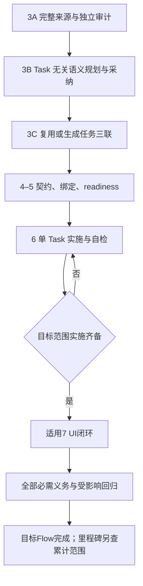

# 来源到实施的阶段与权威合同

## 术语和权威

Requirement 是保留来源回链的规范化投影，验收意图先于 Task；Capability 组织能力而不拥有任务或完成状态。Flow 表示玩法行为和交接，节点不等于 Task 或 Godot 节点。一 Flow 可跨多 Capability，一个 Task 可支撑多个 Flow。每 Requirement 只有唯一权威验证处置／覆盖 owner，但可有多个带可观察角色的 Flow 路线成员关系。共享证据按覆盖行为去重引用，不重复计完成；沿用当前 requirement_route_memberships／requirement_verification／requirement_evidence 的键。

原始 GDD／PRD、批准变更、有效 ADR 管语义；采纳规划保存从属这些来源的版本化决定；back／gameplay 业务视图经审阅编译到 `tasks.json`，后者是唯一任务状态权威；程序契约 SSoT 在 `Game.Core/Contracts/**`；manifest 管累计义务，不是游戏状态机；Knowledge／topology 是可重建关系与证据定位，运行完成由对应身份的原始报告证明。

当前规则为定义和实施依据，不表示已实现。发布游戏不需要读取 Taskmaster、Knowledge 或 Chapter 记录才能运行。采用持久采纳不把全部派生图升级为新语义权威；Chapter 顺序及治理演进须有显式 ADR 变更记录。

## 阶段交接

| 阶段 | 产出及进入后阶段的条件 | 可合法尚不存在的对象 |
| --- | --- | --- |
| 3A | 累计来源注册，完整可定位 Ledger，逐块投影或去向，Requirement／验收意图，完整原始输入范围的独立遗漏与冲突审计 | Task、readiness、场景与实际接口 |
| 3B | 可正式审阅采纳的 Capability／Flow 语义或合法非 Flow 去向；四部分、状态责任、分支、交接和验证目标完整；采纳持久化 | Task ID、实现符号、实际场景、Task readiness |
| 3C | 先盘点已有实现／任务／共享能力，再生成或复用真实缺口；业务视图、审阅、三联编译；需求、责任、依赖及验证去向一致 | 待实施对象与最终运行证据 |
| 4 | 细化 Overlay、程序契约、生产命令、只读状态、状态所有者、适配、绑定及场景资源责任 | 被明确标 planned 的待实施对象 |
| 5 | Acceptance、需求、ADR／Overlay／Contract、依赖和适用义务一致；最终 manifest 或有效其他验证依据与当前 Task readiness 同源 | 待实施任务完成状态及运行通过证据 |
| 6 | 仅实施当前 Task，按有效定义 TDD／检查、评审、Needs Fix、pre-commit、修复与恢复 | 目标 Flow 其他尚未完成任务的结果 |
| 7 | 对目标 backlog slice 确认 UI 闭环，复用6已验证义务，通过治理路径补真正缺口 | 无 UI 义务时本阶段不适用 |
| Flow／里程碑收尾 | 目标全必需义务、受影响回归及适用人工检查；累计里程碑另要求累计范围同整合快照 | 范围外未来义务可保持待实施，但不可宣称通过 |

3A／3B／3C 是职责划分，不预设三个新公共命令。合法非 Flow 仍经历来源记账、独立审计、采纳验证去向、Task 及适用4–6检查；不为满足图示强造 Flow。任务类型本身不免除真实 MVG 影响。

## Flow 与四部分的最低内容

Flow 必须有稳定身份、来源／Requirement、起点与进入条件、成功终点、必要失败／取消／返回分支、交接、状态所有者、结果及验证目标。允许重入、重试和循环；检查必要可达性及退出条件时须说明可判定边界，不能承诺任意玩法必然终止。

| 部分 | 拆 Task 前 | Chapter6 前 |
| --- | --- | --- |
| 领域规则 | 结果、前后条件、允许动作、不变量、状态所有者、失败行为 | 生产命令、只读状态、契约、状态迁移与边界可实施可测；受控入口写状态 |
| C# 场景适配 | 输入提交、状态读取、展示反馈责任 | 薄适配边界、依赖、生命周期、反馈义务明确；不复制领域判断 |
| 绑定 | 逻辑控件→命令／视图状态及主要交接 | 实际对象／资源、类型和生命周期明确；缺失／错配／失效可检查，待建标 planned |
| 场景 | 入口／退出、必要视图、资源／布局职责 | 场景和资源范围、受管与人工制作部分明确，原生场景可编辑 |

Flow 层面完整说明适用四部分；Task 只负责其适用部分，不强制一节点一 Task、四部分各一 Task或每 Task 改四层。共享规则和状态引用同一受治理定义。不适用需有理由，不以空值或假接口取代责任。

## readiness 与入口决策

所有 B Task 的来源、实施依据、采纳规划／验证去向、readiness、Task Acceptance 及适用义务必须属于同一有效输入组。所有公共 CLI、直接实施、恢复和页面触发执行一致规则。

| 当前有效适用性 | 进入实施所需依据 | 无效时 |
| --- | --- | --- |
| 归属 Flow 或承担 MVG 交接／集成／回归 | 共同输入有效，且对应 manifest 绑定有效 | 拒绝并定位缺失、损坏、未知或过期依据 |
| 合法非 Flow，当前确无 MVG 义务 | 共同输入有效，已采纳适用性和其他验证义务有效 | 不可用空字段、标签或 Agent 自报 N/A 放行 |
| 非 Flow 但实际影响 Flow | 其他义务有效，且实际产生的 MVG 回归绑定有效 | 不因任务类型跳过回归 |
| 适用性未知或依据不明 | 不满足放行条件 | 阻断；不得落为 genuine legacy |
| 冻结范围内存量 A | 按已确定的旧路线边界和既有有效依据 | 不扩大旧兼容，不让 B 丢标识混入 |

Task 状态不能替代绑定校验；进入6不要求当前 Task 已 done。producer、consumer、integration-only owner 的义务分开，治理／测试 owner 不必伪造运行时 API，也不能被新增完成条件造成自身 done 依赖。

上游相关语义、解析器、契约、绑定或验证规则变化仅使受影响结果失效，无关变化不重做全仓。适用复用依赖已提交完成成果及当前兼容性；MVG 新执行不移植未完成候选上下文，Capability 显式 --resume-evidence 按其完整输入／receipt 规则独立核对。来源审计不按首轮投影反裁完整输入；Chapter5 复用有效来源审计但继续承担 Task／Acceptance／契约／绑定核对。

## 实施与缺陷路由

Agent 按已绑定定义实施，不凭 Knowledge 摘要或临时全局扫描重新解释需求。Chapter6 不隐式全局 Knowledge refresh。发生定义不足时，形成明确缺口返回拥有该定义的阶段，不改 Acceptance、所有权或验证责任换绿。

纯实现缺陷不改变已采纳玩法定义、契约、状态所有权、交接／绑定设计或验收义务时，复用当前规划；经必要 Task 映射、受影响核对、readiness、局部自检及既有适用回归完成。需要修复 Task 时只补真实缺口，保留历史 done。若触及上述定义，返回定义所属阶段形成受治理变更，不冒充局部修复。

## 能力来源

CAP-1 对应 FR-1／2；CAP-2 对应 FR-3／4／7；CAP-3 对应 FR-5；CAP-4 对应 FR-6；CAP-5 对应 FR-7／8／9；CAP-6 对应 FR-10／11；CAP-7 对应 FR-12；CAP-8 对应 FR-13；CAP-9 对应 FR-14／15／17；CAP-10 对应 FR-16；CAP-11 对应 FR-18。原始 BR 及 AC 的身份保留在 PRD addendum。
